 

 

<h2 align="center">Sobre mim</h2>

Formado em <b>Análise e Desenvolvimento de Sistemas</b> pela FATEC Ipiranga e Assistente de Revenue na <b>Flytour Business Travel</b>, 
onde trabalho com dados, processos e indicadores de garantia de receita.

Gosto de começar pelo problema: entender quem precisa da solução, o que ela tem que resolver e como medir se resolveu. 
Quero crescer em <b>produtos digitais e transformação digital</b>.

 

<h2 align="center">Projeto em destaque</h2>

<table>
  <tr>
    <td width="25%" valign="top"><b>Ciclo completo</b> Da necessidade das áreas ao valor medido, num só lugar.</td>
    <td width="25%" valign="top"><b>Score explicável</b> Prioridade de 0 a 100 com cada ponto justificado.</td>
    <td width="25%" valign="top"><b>Confirmado ≠ estimado</b> O retorno prometido é comparado com o confirmado.</td>
    <td width="25%" valign="top"><b>Decisão registrada</b> Quem decidiu, por quê e qual o próximo passo.</td>
  </tr>
</table>

Idealizei o produto, os módulos e as regras de negócio; a implementação foi feita com apoio de IA. A fase 1 é uma demonstração funcional com dados fictícios, em português e inglês, com painel de acessibilidade e documentação completa (PRD, processos, regras, arquitetura e ADRs).

  

<h2 align="center">Outros projetos</h2>

<table>
  <tr>
    <td valign="top">
      <h3>Cadastro de Pacientes · UBS</h3>
      
      
      
      
Sistema full stack para cadastro de pacientes de uma Unidade Básica de Saúde, desenvolvido em equipe na FATEC.

      
    </td>
  </tr>
</table>

 

<h2 align="center">Ferramentas</h2>

**No dia a dia**

**Da formação**

 

Tecnologia · Negócios · Pessoas

